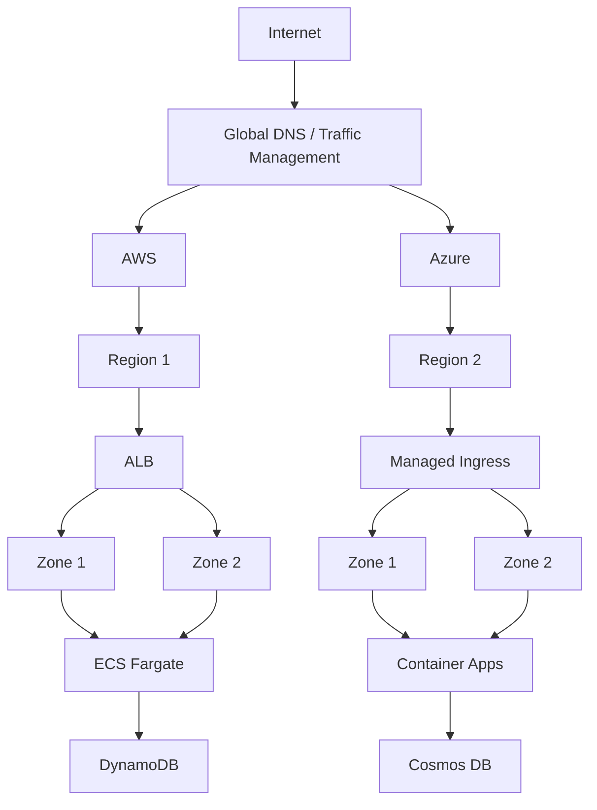
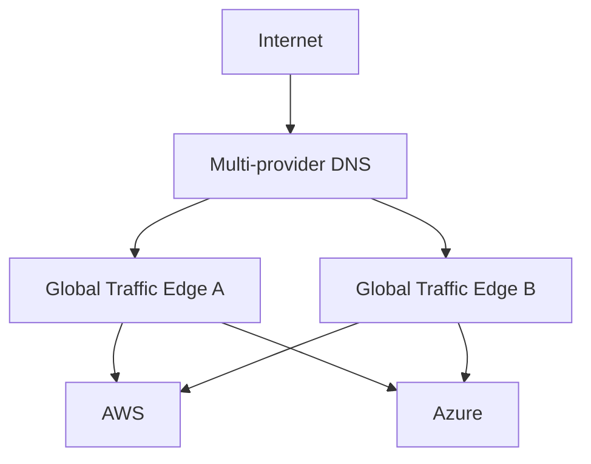
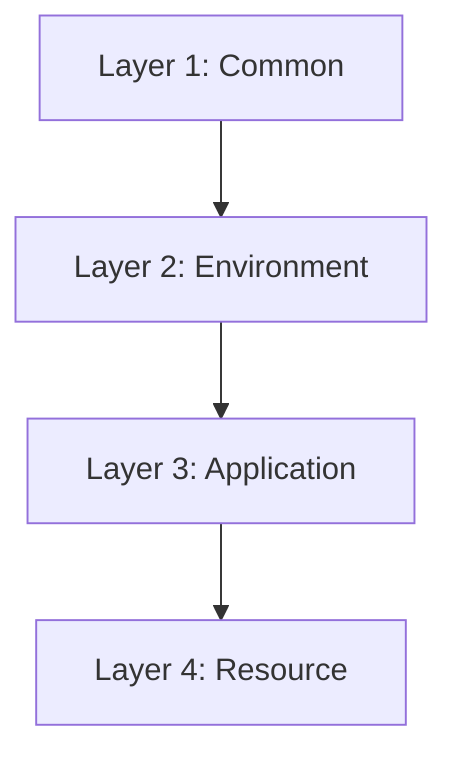
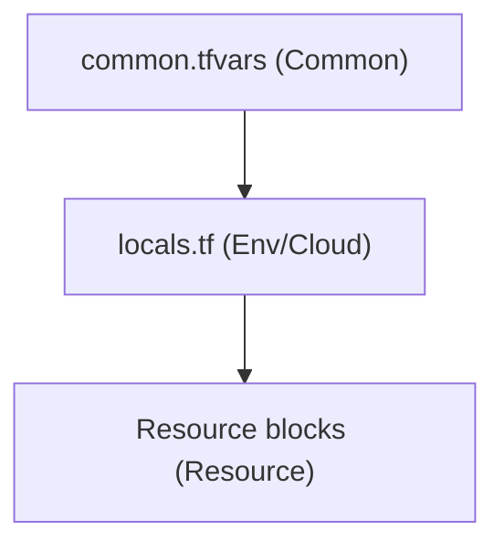

# Terraform Multi-cloud Container Lab

## Objective
Demonstrate a containerized application independently deployed into both AWS and Azure, wiith each cloud able to serve the application if the other cloud becomes unavailable. Infrastructure is deployed with Terraform, global traffic management avoids introducing unnecessary single-cloud dependency.

Cloud providers have many service offerings that allow many different architectual designs that can serve the same application. This exercise is meant to illustrate different single points of failure (failure domains) and how to overcome them using a classic infrastrucutre archecture. Obviously, care should always be taken to evaluate actual application requirements, business requirements, security requirements, contractual service level aggreement (SLA) and Recovery Time Objective (RTO), as well as expected traffic load, and budget. Answering those questions will start to define the preferred implementation.


### What's not the objective?
In this exercise, I'm not focusing on full perimeter security for the application such as WAF, DDOS, Rate-limiting, etc. Remember, this is just a simple multi-cloud implementation project.

I'm also not focusing on a fully distributed data layer. Honestly, that is probably worth implementing within its own dedicated project. Fully distributed data layers can be complex and expensive. They require at least 3 distinct hosting platforms with secure and highly-available, low-latency, inter-connectivity in order to achieve quorum.

## Target Failure Domains
The list below describes intended outcomes, not implemented or verified coverage. Infrastructure and resiliency tests are not complete. Each level of resiliency can reduce risk, but also increases cost to achieve and maintain.

- [ ] Application level resiliency
  - AWS ECS Fargate and Azure Container Apps allow multiple instances of the container application to be running, which helps protect against single points of failure at the container/application level.
- [ ] Service level resilency
  - Running containers in multiple zones helps protect against service level failures as well as complete zone level failures.
- [ ] Geographic level resiliency
  - Regional diversity, whether implemented within a single provider, or across multiple providers, helps protect against reagional level failures. East/West isolation makes the most sense here. I'd much rather see additional latency impact the application over total failure because of region overlap between the providers.
- [ ] Provider level resiliency
  - Multi-cloud providers protect against complete provider failure. This implementation is using single-region for each provider and that creates a joint failure domain where a regional outage is also considered a provider outage. You could avoid that joiint failure domain by implementing multiple regions for each provider, but at that point, your cloud spend is drastically increasig for not that much gain in my opinion. If not implementing multiple providers, you should absolutely consider multi-region within your provider of choice.
- [ ] Global DNS / Traffic Manager resiliency
  - This level of resiliency is not implemented within this project as most Global DNS / Traffic Management solutions (CloudFlare, Akamai Edge DNS, Fastly, etc) are already highly avaiable solutions. Implementing this level of resiliency is possible, and could look something like the following diagram. Obvioulsy the cost continues to increase drastically, and honestly a invalid DNS record update could still completely take you out, which would be incredibly difficult and embarrasing to explain to upper management. Deeper research is crtical for this type of implementation because you would want to deploy a solution that doesn't have its own inner-cloud dependencies for the same cloud providers you are trying to utilize.




## Implementation
This project is intended to demonstrate terraform infrastructure as code, but we have a couple of classic "chicken and egg" problems that will be resolved through limited manual steps and bootstrapping using local Terraform state. The problem: We cannot use remote state or OIDC authenticated pipelines until certain infrastructure exists. The solution: To resolve this, minimal manual actions will be taken to establish access to the cloud providers, and then some minimal terraform bootstrapping will establish our remote state configurations as well as our offical CI/CD role for the github actions workflow. Eveything beyond that will be created with terraform remote state in place.

### Day 0
1. Create/activate the AWS account - Manual
   - Establish administrative access
   - Configure MFA
   - Configure billing
   - Record the AWS account information
2. Create/activate the Azure subscription - Manual
   - Establish Microsoft Entra ID administrative access
   - Configure MFA
   - Record the Azure subscription information
3. Install or update tools "if needed" - Manual
   - Git
   - Terraform (Needed for initial bootstrap execution)
   - AWSCLI tools (Needed for initial bootstrap access)
      - Configure and authenticate AWSCLI tools
   - AzureCLI tools (Needed for initial bootstrap access)
      - Configure and authenticate AzureCLI tools
   - Docker (Needed to develop and test the container app locally)
4. Create a new github repository (This project requires a Github account because we'll be using github actions workflows) - Manual
   - Clone the new github repository locally
   - Create a new branch
5. Scaffold out the project files and directories (Bash script below)
6. Create the bootstrap terraform
7. Execute the bootstrap terraform locally

The following bash script will help seed the project files and directories.

``` shell
#!/bin/bash

TF_ROOT="$PWD/terraform"
CLOUD_PROVIDERS=("aws" "azure")
ENVS=("lab") # Add more environments as needed

# Create the Terraform root directory and environment directories
for ENVIRONMENT in "${ENVS[@]}"; do
    mkdir -p "${TF_ROOT}"/config/envs/"${ENVIRONMENT}"
    touch "${TF_ROOT}"/config/envs/"${ENVIRONMENT}"/{aws.tfvars,azure.tfvars}
done

# Create the common.tfvars file
touch "$TF_ROOT/config/common.tfvars"

# Create the github workflow directory and validation yml
mkdir -p "${PWD}"/.github/workflows
touch "${PWD}"/.github/workflows/terraform-checks.yml

# Create the provider specific directories and files
for PROVIDER in "${CLOUD_PROVIDERS[@]}"; do
    mkdir -p "${TF_ROOT}"/bootstrap/"${PROVIDER}"
    mkdir -p "${TF_ROOT}"/platform/"${PROVIDER}"
    touch "${TF_ROOT}"/bootstrap/"${PROVIDER}"/{versions.tf,provider.tf,variables.tf,outputs.tf,locals.tf,main.tf,data.tf}
    touch "${TF_ROOT}"/platform/"${PROVIDER}"/{versions.tf,provider.tf,variables.tf,outputs.tf,locals.tf,main.tf,data.tf,backend.tf}

    # Create the module directories and files
    mkdir -p "${TF_ROOT}"/modules/"${PROVIDER}"/{bootstrap,network,containers,data,observability}
    touch "${TF_ROOT}"/modules/"${PROVIDER}"/bootstrap/{variables.tf,outputs.tf,locals.tf,data.tf,state.tf,oidc.tf,auth.tf}
    touch "${TF_ROOT}"/modules/"${PROVIDER}"/{network,containers,data,observability}/{variables.tf,outputs.tf,locals.tf,data.tf,main.tf}

    # Creat the provider specific github workflow yml files
    touch "${PWD}"/.github/workflows/terraform-"${PROVIDER}".yml
done

# Create common modules and seed the terraform files
    mkdir -p "${TF_ROOT}"/modules/common/naming
    touch "${TF_ROOT}"/modules/common/naming/{variables.tf,outputs.tf,locals.tf,main.tf}
```

Now we should have the following directory structure.

```
PROJECT_ROOT
├── .github
│   └── workflows
│       ├── terraform-aws.yml
│       ├── terraform-azure.yml
│       └── terraform-checks.yml
├── .gitignore
├── README.md
└── terraform
    ├── bootstrap
    │   ├── aws
    │   │   ├── data.tf
    │   │   ├── locals.tf
    │   │   ├── main.tf
    │   │   ├── outputs.tf
    │   │   ├── provider.tf
    │   │   ├── variables.tf
    │   │   └── versions.tf
    │   └── azure
    │       ├── data.tf
    │       ├── locals.tf
    │       ├── main.tf
    │       ├── outputs.tf
    │       ├── provider.tf
    │       ├── variables.tf
    │       └── versions.tf
    ├── config
    │   ├── common.tfvars
    │   └── envs
    │       └── lab
    │           ├── aws.tfvars
    │           └── azure.tfvars
    ├── modules
    │   ├── aws
    │   │   ├── bootstrap
    │   │   │   ├── auth.tf
    │   │   │   ├── data.tf
    │   │   │   ├── locals.tf
    │   │   │   ├── oidc.tf
    │   │   │   ├── outputs.tf
    │   │   │   ├── state.tf
    │   │   │   ├── variables.tf
    │   │   ├── containers
    │   │   │   ├── data.tf
    │   │   │   ├── locals.tf
    │   │   │   ├── main.tf
    │   │   │   ├── outputs.tf
    │   │   │   └── variables.tf
    │   │   ├── data
    │   │   │   ├── data.tf
    │   │   │   ├── locals.tf
    │   │   │   ├── main.tf
    │   │   │   ├── outputs.tf
    │   │   │   └── variables.tf
    │   │   ├── network
    │   │   │   ├── data.tf
    │   │   │   ├── locals.tf
    │   │   │   ├── main.tf
    │   │   │   ├── outputs.tf
    │   │   │   └── variables.tf
    │   │   └── observability
    │   │       ├── data.tf
    │   │       ├── locals.tf
    │   │       ├── main.tf
    │   │       ├── outputs.tf
    │   │       └── variables.tf
    │   ├── azure
    │   │   ├── bootstrap
    │   │   │   ├── auth.tf
    │   │   │   ├── data.tf
    │   │   │   ├── locals.tf
    │   │   │   ├── oidc.tf
    │   │   │   ├── outputs.tf
    │   │   │   ├── state.tf
    │   │   │   └── variables.tf
    │   │   ├── containers
    │   │   │   ├── data.tf
    │   │   │   ├── locals.tf
    │   │   │   ├── main.tf
    │   │   │   ├── outputs.tf
    │   │   │   └── variables.tf
    │   │   ├── data
    │   │   │   ├── data.tf
    │   │   │   ├── locals.tf
    │   │   │   ├── main.tf
    │   │   │   ├── outputs.tf
    │   │   │   └── variables.tf
    │   │   ├── network
    │   │   │   ├── data.tf
    │   │   │   ├── locals.tf
    │   │   │   ├── main.tf
    │   │   │   ├── outputs.tf
    │   │   │   └── variables.tf
    │   │   └── observability
    │   │       ├── data.tf
    │   │       ├── locals.tf
    │   │       ├── main.tf
    │   │       ├── outputs.tf
    │   │       └── variables.tf
    │   └── common
    │       └── naming
    │           ├── locals.tf
    │           ├── main.tf
    │           ├── outputs.tf
    │           └── variables.tf
    └── platform
        ├── aws
        │   ├── backend.tf
        │   ├── data.tf
        │   ├── locals.tf
        │   ├── main.tf
        │   ├── outputs.tf
        │   ├── provider.tf
        │   ├── variables.tf
        │   └── versions.tf
        └── azure
            ├── backend.tf
            ├── data.tf
            ├── locals.tf
            ├── main.tf
            ├── outputs.tf
            ├── provider.tf
            ├── variables.tf
            └── versions.tf
```
## Variable Declarations and Validation
Variable declaration should follow a layered approach to miinimize duplication. Validation should be done by the consumer to also minimize duplication, however, this project will have some level of duplicated validation due to the nature of its structure.

- common.tfvars defines shared values.
- Cloud-specific .tfvars files define provider-specific values per environment.
- Bootstrap and platform each declare and validate the variables they consume. Some overlap is likely.
- Individual modules validate their own inputs.
- CI/CD validates both root configurations independently.
  - -var-file="../../config/common.tfvars"
  - -var-file="../../config/envs/`environment`/aws.tfvars"

## Resource Naming Conventions
Often times, naming conventions are either poorly planned or maybe not even considered until it's too late and very difficult to adjust. There is no fast and hard rules on how your naming convention must be comprised, and there are bound to be many different opinions and arguments out there on the subject. What's most important is that your naming convention is one that meets your business needs and is compatible with your application design. For this particular project, we'll be using the following criteria.

### Objective
The standard should support:
- Cross-cloud indentification
- Centralized logging, monitoring, reporting
- Multi-account and multi-subscription environments
- Multi-region within the same accounts
- Provider-specific resource naming restrictions
- Stable Terraform automation using consistent patterns
- Windows compatible computer names due to legacy NetBIOS 15 character constraint

### Guiding Principals
1.  Must be determinstic and computable by Terraform
2.  Must clearly identify the cloud proivider
3.  Must clearly indentify the account/subscription boundary
4.  Must respect provider-specific character and length restrictions
5.  Should use short, standardized environment identifiers, whenever it adds value
6.  Should use standardized region aliases instead of long provider-specific names, whenever it adds value
7.  Should include an application/workload identifier, whenever is adds value
8.  Should include the resource type, whenever it adds value
9.  Should provide uniqueness without maintaining unnecessary global increments
10. Should keep names as minimal, human readable identifiers, while placing more descriptive metadata into tags
11. Should not encode information into names without providing value
12. Should have a deliberate exception for virtual-server names if there is a chance of dealing with legacy Windows/NetBIOS 15 character constraint

### Terraform Enforcement
Naming should be centralized using a custom common module instead of constructed indpendently by each resource.

Caller/root `variables.tf` files should validate the controlled context catalogs and objects. The naming module consumes those resolved values as trusted inputs and does not repeat catalog validation.

Terraform should enforce:
- Approved provider codes
- Approved environment codes
- Approved region mappings
- `Application.code` must be 2-10 characters and validated by the caller/root; current Terraform roots pass it as `project.code`
- Resource `type` must be 2-10 alphanumeric characters; the naming module normalizes it to lowercase
- Approved server-role codes
- Four character account identifiers by parsing the last 4 characters fom the account/subscription
- Stable, state-backed random resource suffixes when uniqueness is required
- Server name character limitations (15 character maximum)
- Lowercase naming unless otherwise required by a provider-specific resource

### General Cloud Resource Convention

| Component | Width | Example |
| --- | --- | --- |
|Provider|2|aw, az|
|Account/Subscription|4|5309, 7c42|
|Application code (Terraform `project.code`)|2-10|mc|
|Environment Name|3|dev, tst, prd|
|Region (optional)|3|ue1, uw2|
|Resource type (`type`)|2-10 alphanumeric|vpc, vnet, alb, lb|
|Descriptor (optional)|3-10 lowercase alphanumeric|common, web, app|
|Random suffix (optional)|4 lowercase alphanumeric characters|a7f3|

```
{cloud.code}-{account.code}-{project.code}-{environment.code}-{region.code?}-{type}-{descriptor?}-{random_suffix?}
```
Example:
`aw-5309-mc-prd-ue1-alb`

Example with optional random_suffix component:
`aw-5309-mc-prd-ue1-s3-a7f3`

Example with optional descriptor and random suffix:
`aw-5309-mc-prd-ue1-s3-common-a7f3`

The caller/root validates `Application.code` (currently passed as `project.code`) before passing the resolved `project` context to the naming module. The code must be 2-10 characters. The naming module validates `type` as 2-10 alphanumeric characters and renders it in lowercase.

### Compact General Resource Names
Set `compact = true` to render the same components without delimiters. An optional region is inserted before the type; an optional random suffix is appended directly.

```
{cloud.code}{account.code}{project.code}{environment.code}{region.code?}{type}{descriptor?}{random_suffix?}
```
Example:
`aw5309mcprdue1alb`

### Naming Profile Selection
- Supplying a role selects the compute profile.
- Otherwise, `compact = true` selects the compact profile.
- Otherwise, the standard profile is used.

#### Optional Components
Optional components should be omitted whenever they do not apply or add value, but they should not be omitted arbitrarily.

Examples:
- Omit region for global resources
- Omit instance for singleton resources
- Use the compact profile when the resource does not permit hyphens
- If a provider limit is exceeded, shorten `type`, remove the random suffix when possible, or use the compact profile. The naming module does not truncate or hash names.

#### Cloud Provider Codes
Use two-character codes to identify cloud providers.

|Cloud Provider|Code|
| --- | --- |
|AWS|aw|
|Azure|az|
|Google|gc|

#### Environment Codes
Use three-character environment codes whenever possible. An execption such as "dr" is acceptible, because it might lose clarity if forced into a three-character code.

|Environment|Code|
| --- | --- |
|Lab|lab|
|Development|dev|
|Test|tst|
|Staging|stg|
|User Acceptance|uat|
|Production|prd|

#### Region Codes
Region aliases represent logical geography and remain simple and consistent regardless of provider. This project uses one region in US East and one in US West.

|Geography|Code|AWS|Azure|
| --- | --- | --- | --- |
|Eastern US|ue1|us-east-1|eastus|
|Eastern US|ue2|us-east-2|eastus2|
|Western US|uw1|us-west-1|westus|
|Western US|uw2|us-west-2|westus2|

|Provider Priority|Priority `id`|
|Primary|1|
|Secondary|2|

The `id` field is a provider-local priority identifier, not a shared geography identifier: `1` means primary and `2` means secondary within that provider. AWS intentionally uses Eastern US as primary and Western US as secondary; Azure intentionally reverses that placement. Keep the geography `code` stable across providers while keeping the priority `id` aligned with each provider's primary/secondary choice. This separates regional boundaries across providers when each operates in only one region.

#### Account and Subscription Codes
Use the last 4 characters of the provider account/subscription identifier. This identifies the resource boundary when data from multiple accounts or subscriptions are aggregated into shared reporting.

```
AWS Account 1234567890 -> 7890
Azure subscription ...7c42 -> 7c42
```

#### Uniqueness
Use the optional `descriptor` to distinguish related resources with a 3-10 character lowercase alphanumeric value; it appears after `type` and before the random suffix. Add a random suffix only when uniqueness is required. For general cloud resources, set `random_suffix = true`; the naming module generates a four-character lowercase hexadecimal suffix using a state-backed resource. The suffix remains stable in Terraform state, and each naming-module instance gets its own suffix. The module does not perform provider collision detection or retries. Do not derive resource names from timestamps or other values that can change between Terraform runs.


### EC2 / VM Naming Convention Exception
Virtual machine naming is a bit tricky if you have to deal with Windows and any legacy NETBIOS configurations in an Active Directory domain. The following convention helps eleviate that constraint.

```
{provider}{Account}-{role}{region id}{environment id}{instance id}
```

| Component | Width | Example |
| --- | --- | --- |
|Provider|2|aw, az|
|Account/Subscription|4|5309, 7c42|
|Delimiter|1|-|
|Role|3-4|web, app|
|Region Id|1|1|
|Environment Id|1|1|
|Instance Id|2|01|
|Total|14-15|aw5309-web1101|


## Tagging
Tagging adds valuable metadata to cloud resouces, which can be used to identify, organize, manage, secure, and track the cost of cloud infrastructure. Just as with a naming convention, a good tagging strategy also requires some thought and planning.

### Tag Stratgey Guidance

- Standardize tag names: Determine the exact tag key names, including format such as PascalCase, and apply them consistently. I personally like the idea of using kebab-case with a custom prefix to help isolate custom tags from any other system tags that get added. Whatever you decide, be consistent and apply the same standards to all resources.
- Use controlled values: Use controlled values and consistent value formats. Email addresses, team names, cost-center codes, and dates should follow documented formats. Do not use free-text values.
- Require critical tags: Determine which tags are critical for resource management and business functionality and require them.
- Automate enforcement: If any tags are required, use policy to detect and prevent non-compliance.
- Monitor and report: Review missing, invalid, or outdated tags and values.
- Avoid sensitive information: Never add confidential information into tags.

### Tag Implementation
Once there is a tag strategy, the next step is to determine how to organize and implement them within Terraform. This project will use a layered approach, defining tags at multiple levels of scope. Using Terraform's merge() function, each layer adds tags as the scope becomes more specific. One thing about the merge() function to keep in mind, when keys collide, the last last merge wins.

#### Example:



#### Design:
This particular project has multi-cloud providers per environment so my layering model will vary slightly.


